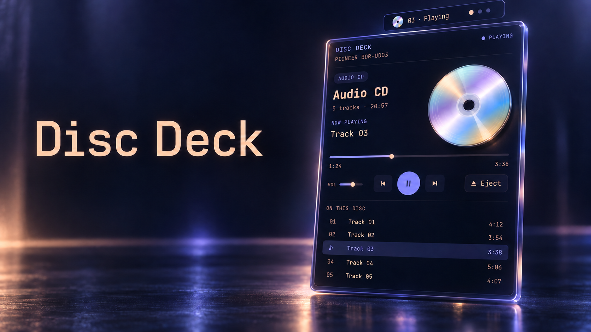

# Disc Deck



A native Omarchy bar plugin for audio CDs and optical drives. Open a player from the bar, browse tracks, control playback, and eject your disc.

The interface follows your Omarchy theme.

## Install

Requires Omarchy with its Quickshell plugin system, Python 3, mpv with CDDA support, udisksctl, eject, and xdg-open.

```bash
omarchy plugin add https://github.com/HakataMike/disc_deck_omarchy.git --enable
```

The plugin ID is `hakatamike.disc-deck`. It defaults to the right side of the bar and hides when the optical drive is disconnected.

If you already installed a local copy with the same ID, back it up before replacing it with the Git-managed version.

## Controls

Click the disc icon to open the player. Insert an audio CD and press Play or click a track.

| Action | Control |
| --- | --- |
| Play or pause | Space, playback button, or middle-click the bar icon |
| Previous or next track | Left/Right arrows or skip buttons |
| Seek | Click or drag the progress slider |
| Volume | Volume slider, Up/Down arrows, or scroll over the bar icon |
| Refresh drive status | R |
| Close the popup | Escape or click outside |
| Eject disc / close tray | Eject / Close tray button |
| Browse a data disc | Open files button |

Closing the popup leaves music playing. Changing or disconnecting the disc stops playback. Data discs are unmounted before ejection.

To hide or re-enable the widget:

```bash
omarchy plugin disable hakatamike.disc-deck
omarchy plugin enable hakatamike.disc-deck --section right
```

To uninstall:

```bash
omarchy plugin remove hakatamike.disc-deck
```

## How it works

QML renders the bar widget and native popup. A Python helper reads the optical drive and CD table of contents; mpv provides audio playback through a local IPC socket. udisksctl handles data-disc mounting and unmounting.

Tracks use generic labels such as “Track 01” and show durations read from the disc. Online album lookup and CD-TEXT titles are not implemented. The first detected `/dev/sr*` optical drive is selected.

The helper and player run as the desktop user. One backend owns playback across bar instances and exits with the shell. Runtime state and the mpv log live in `$XDG_RUNTIME_DIR/omarchy-disc-deck/`.

Disc labels, drive names, track titles, and errors render as plain text. HTML-like metadata is displayed literally and cannot load inline images.

## Validation

```bash
python3 check_backend.py
python3 check_text_rendering.py
omarchy plugin validate .
```

The backend checks require ffmpeg and mpv. They cover track timing, mixed audio/data tracks, mount paths containing spaces, optical-only operations, and real mpv IPC with silent synthetic media. Play/pause, seeking, track changes, volume limits, and cleanup passed.

Text rendering checks require Qt 6's `qmltestrunner` and QtTest QML module. They exercise the production text items offscreen with normal, Unicode, and HTML-image payloads. A loopback-only HTTP server verifies that metadata triggers no image requests; an automatic-format positive control confirms that the check can detect a request.

Drive detection was verified with a Pioneer BDR-UD03. Popup opening, Escape dismissal, and toggle dismissal were verified in the installed Omarchy shell. Physical audio-CD playback and data-disc mounting/ejection still need testing with inserted media.

## Source

`manifest.json` is the repository entry point; `plugin/` contains the QML interface, artwork, and Python backend. Local desktop captures, logs, and configuration backups are excluded from this repository.

## License

MIT License. See [LICENSE](LICENSE).
